# [Anti-Interference]FMCW Car Radar Interference Reduction Based on Constant False Alarm Rate [with MATLAB Code]

In this paper, a method based on Constant False Alarm Rate (CFAR) detectors is proposed to mitigate interference in Frequency Modulated Continuous Wave (FMCW) radar. The proposed method leverages the fact that after de-linearization and low-pass filtering, the differenced signal of FMCW radar targets consists of exponentially sinusoidal components, while interference presents as short-duration linear frequency modulation waves within the scanned area. In the time-frequency domain (t-f), one-dimensional Constant False Alarm Detectors are utilized to detect the spectrum of interference along each frequency point, followed by expanding the detected spectrum map as an interference suppression mask. The proposed method is applicable to scenarios with multiple interference sources. Compared to existing methods, the proposed approach reduces power loss of useful signals and achieves high computational efficiency. Its interference suppression performance is demonstrated through numerical simulations and experimental results.
Differential Signal, Constant False Alarm Detector, Frequency Modulated Continuous Wave Radar, Interference Suppression, Time-Frequency Spectrum.
I. Introduction: Frequency Modulated Continuous Wave (FMCW) radar has become a key device for automotive assistance/autonomous driving due to its all-weather and all-time capabilities along with low cost. With the increase in the number of vehicles equipped with radar sensors, FMCW radar systems installed on different cars in busy areas will inevitably be subject to strong interference from other radar systems on adjacent cars and other radars on the same car at the same time. Such strong interference can lead to a significant increase in background noise, weakened target masks, and reduced detection probability of targets. Therefore, to overcome these risks, effectively mitigating interference from other radars is crucial for high-performance automotive radars.
Vehicle radar jamming suppression has been a research hotspot in recent years. In the literature, numerous methods have been proposed and developed to suppress interference between different vehicle radars, which can be categorized into three types: radar system coordination, radar system design, and waveform design, as well as signal processing. For the radar system coordination method, centralized or distributed coordination schemes between different operating radars have been designed to adjust operational parameters (i.e., transmission time, spectrum, etc.) within the interference area. Although these coordination schemes originating from communication networks can effectively avoid certain interference, they often require the introduction of additional coordination units into existing FMCW radar systems, or require communication with the coordination center of the local distributed radar network.
On the other hand, new radar system architectures and waveforms have been proposed to facilitate interference suppression [4]-[10]. Frequency Hopping Random Linear Frequency (FHRL) FMCW technology [4], [5] and FMCW radar with random repetition intervals are capable of resetting parameters of linear frequency modulation signals (bandwidth, scanning duration, center frequency, and repetition interval) each cycle, leading to a class noise frequency response that causes interfering noise after downconversion and demodulation of received signals. Both technologies can effectively suppress local interference and avoid false targets caused by mutual interference. However, the randomized repetition intervals will prevent the use of conventional fast Fourier transform for rapid Doppler processing. On the other hand, pseudorandom noise signals [8] and chaotic sequences [7] are introduced to mitigate mutual interference in automotive radar systems. For these radar systems, received signals are processed through correlation operations, and the analog-to-digital converter (ADC) usually requires high sampling frequencies, which increases the cost of the radar system. To leverage the advantages of both class noise signals and FMCW radar systems, phase modulation (PM) FMCW radar systems utilize orthogonal or random sequence modulation of FMCW waveforms as the transmit signal [9], [10]. At the receiving end, the PM-FMCW signal received can be downconverted like traditional FMCW radar, then decoded by correlating with the stored sequence used for transmission modulation. Scattered signals produced by the transmit signal typically lead to high correlation peaks, while uncorrelated interference will spread and establish a noise baseline after decoding. The enhanced noise baseline can overwhelm weak targets and reduce detection probability. Moreover, PM-FMCW radar cannot easily be implemented using existing FMCW radar chips, and new radar architectures need to be designed.
Additionally, for FMCW radars, numerous IM methods have been developed, which include traditional signal processing techniques and deep learning-based approaches. Traditional signal processing techniques typically involve constructing nulls in the direction of arrival (DOA) of interference by beamforming in various domains (i.e., spatial, temporal, frequency, time-frequency, etc.). For array-based radar systems, interference mitigation can be achieved through beamforming in the direction of arrival of interference (DOA) [11]-[13]. However, these methods suppress the target scattering signals from the same DOA of interference. In [14], interference is detected based on thresholds, followed by suppression through a time window. In [15], an iterative correction method based on empirical mode decomposition is proposed, decomposing the low-pass filter output of FMCW radar into a series of empirical modes in the time domain. In [16], wavelet denoising methods are used to separate the interference from the useful signal. Both methods implicitly assume that interference is sparse in time within the received signal, and their performance decreases as the proportion of interference contaminated samples increases. In contrast, adaptive noise cancellers (ANC) [17] are used to suppress interference in the frequency domain. Although computationally very efficient, their performance largely depends on whether an appropriate reference input for the adaptive filter can be found. In literature [18], firstly, the interference contaminated signal samples of FMCW radar are cropped in the short-time Fourier transform (STFT) domain, then a Burg-based method is proposed based on autoregression (AR) to reconstruct the signal in the cropped area. The modeling is done along each frequency bin. However, as the number of removed areas in the signal increases, the accuracy of the signal recovered using this method rapidly declines. Moreover, recent deep learning methods have been employed for interference mitigation in FMCW radars [19] and [20]. These methods generally require large datasets to be trained under various conditions.
A method for interference mitigation in FMCW radar based on a constant false alarm rate (CFAR) detector is proposed. In this framework, the differenced signal obtained is transformed into the time-frequency (t-f) domain using the Short Time Fourier Transform (STFT). Subsequently, a one-dimensional (1-D) CFAR detector [21] is utilized to detect interference and an extended detection map is used to generate a mask for interference suppression. Specifically, a simple method involves using the generated mask to zero out samples contaminated by interference. Another method maintains their phase but corrects their amplitude based on the average of the amplitudes of uncorrupted samples in corresponding frequency bins derived from the obtained mask. These methods are respectively known as CFAR-Zeroing (CFAR-Z) and CFAR-Amplitude Correction (CFAR-AC) methods. Furthermore, Burg's signal extrapolation [18] can be easily integrated into this framework to achieve more accurate signal reconstruction at each frequency point. For convenience, the resulting method is referred to as CFAR-Burg. Compared with existing methods, the proposed approach can alleviate multiple types of interference and minimize power loss of useful signals to the greatest extent.
Their IM performance has been validated through numerical simulations and experimental results. Moreover, they are highly effective in achieving real-time IM for FMCW automotive radar. The rest of this paper is organized as follows: Section 2 briefly introduces the signal model of FMCW radar. Subsection 3 then presents an interference suppression method based on constant false alarm rate. To demonstrate the interference suppression performance of the proposed method, numerical simulations and experimental results are presented in Sections 4 and 5. Finally, conclusions are drawn in Section 6.
II. Signal Model and Interference Reduction Method Based on Constant False Alarm Rate
​  
Editor
Where f0, K and T represent the starting frequency of FMCW signal, scanning slope and duration respectively. In the case of single-reflection scattering, the scatter signal from a point target is the summation of the delayed emission signal. Simultaneously, it is assumed that the scatter signal from the target is contaminated by sint (t) during its reception period. After performing linear frequency modulation de-modulation and low-pass filtering on the receiver, the obtained differential beat signal is represented as...
​  
Editor
Among them, the convolution operation is represented by p(t). The complex conjugate of p(t) is used to solve linear frequency modulation.
​  
Editor
Fig. 1. (a) Discrete-time beat signal of FMCW radar with interference and (b) its spectrum in t-f domain.
Therefore, for narrowband, wideband, and FMCW waveforms with a scanning slope different from the disturbed FMCW signal, the residual part s_int(t) after de-linearization and low-pass filtering appears as the superposition of some linear frequency modulation pulses in the time domain (see Figure 1(a)) [22]. Therefore, the t-f domain corresponding objects of the scattering body's differential beat signal after STFT are shown as straight lines along the corresponding frequency bins, while the interference is shown as diagonal lines, as shown in Figure 1(B). The different distributions of useful differential beat signals and interference prompt us to propose the following CFAR-based IM method. Note that FMCW interference with the same scanning slope and frequencies falling within the received bandwidth will cause false targets, but their occurrence probability is very small [23]. This is a challenging situation where IM's FMCW radar and dedicated methods must be developed, which is the scope of this paper.
3. Interference suppression methods based on constant false alarm rate (CFAR) are crucial for effective interference inhibition. Based on the analysis of the different distribution characteristics of useful signals and interference in the t-f domain, i.e., the straight line along frequency bins for useful signals and the slanted line for interference, detecting interference can be transformed to differentiate signals distributed along the slanted lines relative to the frequency axis. Therefore, we propose using a one-dimensional CFAR detector to detect interference at each frequency point in the t-f domain and then suppress them.
The complete CFAR-based IM method is shown in algorithm 1. In principle, it includes three main execution steps, which will be detailed below.
A. Applying STFT for time-frequency analysis to the collected signal in (2), where its t-f spectrum is obtained as:
​
Edit
In which w(τ) is the window function, such as a Gaussian window or Hann window. For N discrete signal samples, s[k] = s(kt), k = 0, 1, ..., N-1, the discrete t-f spectral samples on the regular grid are usually calculated by the following formula:
​
Edit
Where t is the time sampling interval, τ is the sliding step of the window, f is the frequency sample step. It can be seen that for a fixed time delay m, through the use of Fast Fourier Transform (FFT), the window τ (4) can be effectively implemented. For convenience, τ = l·t and l is an integer greater than or equal to 1. The t-f spectrum is obtained as a two-dimensional matrix, whose dimensions are Nt × Nf along the time and frequency axes, where Nt is the sliding step of the time window and Nf is the number of FFT points.
Then, the spectrum graph is obtained as the square of the amplitude of the t-f spectrum, given by the following formula:
​
B. Constant False Alarm Rate (CFAR) Detection and Template Expansion
In this step, the objective is to detect interference. Since the spectrum of interference is usually much stronger than that of the useful signal (otherwise, interference mitigation becomes not very necessary), a cell-averaged CFAR (CA-CFAR) detector can be used to detect peaks in the signal spectrum within each frequency bin in the t-f domain [21]. By applying the CA-CFAR detector to the spectral density along each frequency bin, a detection map D can be obtained, which is a matrix with the same size as the spectral map. The detection matrix D has entries of 1 and 0, and the 1 indicates the position of the detected spectral peak in each frequency bin, i.e., the spectral of the interfered signal detected. The number of protection units and training units, the false alarm probability, and the threshold factor of the CFAR detector can be set according to different scenarios.
After obtaining the detection map D using the CFAR detector, it can be used as a mask to suppress interference. However, since there may be multiple interfered spectral samples contaminated at one frequency point, the calculated threshold will be larger, leading to missed edges of the interfered units. To overcome this issue, an expansive process widely used in image processing [24] is utilized to slightly expand the detected interfered mask. By using disk/octagonal structure elements, the single-value pixels (i.e., the detected interfered contaminated samples in the detection map D) are expanded into Idl, and the expanded detection map Ddl is obtained.

Editor
C. Interference Suppression and Signal Recovery
The expanded detection map Ddl of the interfered suppression can be used as a mask for interference mitigation. With the expanded detection map, a simple method for interference suppression is to zero out the interfered contaminated signal samples in the t-f spectrum Stf, simply referred to as CFAR-Z for simplicity. However, the nulling operation not only suppresses the interfered signals but also suppresses the useful signals, resulting in a power loss of the target signal.
To avoid signal power loss in the CFAR-Z method, we recommend using amplitude correction methods based on the CFAR detection plots for interference contaminated samples [25]. This approach is referred to as CFAR-AC. The basic idea of this method is to replace the amplitude of the interfered contaminated sample with the average amplitude of the uncontaminated spectrum samples at corresponding frequency points, while keeping their phase unchanged. The restored value Stf[mi,ni] of the interfered contaminated sample is given by:

Edited

In which, S tf[mi,ni] is the restored value of the sample located at [mi,ni] after interference suppression, arg(x) takes the phase of complex number x. Lni represents the set of indices of uncontaminated samples in the nth frequency interval, and has NLni elements. Therefore, the restored amplitude Ani significantly suppresses strong interference in the nth frequency bin. By repeating the same processing for all frequencies, the amplitudes of all interfered contaminated samples can be corrected, and interference is significantly suppressed. Note that the phase of these samples may still be affected by interference.
On the other hand, after performing CFAR-Z operation on the t-f domain spectrum, it is easy to use Burg-based extrapolation methods [18] and other extrapolation methods [22] to reconstruct the removed samples of useful signals, which can overcome the phase interference in CFAR-AC and potentially obtain a more accurate reconstruction of the removed samples of useful signals. This combined method of CFAR detection and Burg extrapolation is called CFAR-Burg. For simplicity, here we omit the Burg extrapolation, more details can refer to [18].
After suppressing and/or reconstructing interfered contaminated samples, the inverse STFT (ISTFT) is applied to the suppressed t-f spectrum to reconstruct the target beat signal in the time domain.
Additionally, it should be noted that although the phase of the restored samples is still affected by interference, its impact can be negligible after further coherent distance compression and/or Doppler processing. Moreover, for array signals simultaneously subjected to the same interference, the CFAR-AC method does not affect beamforming performance while maintaining signal phase unchanged.
Numerical simulation results show the interference mitigation performance of the proposed method. At the same time, the results are compared with two state-of-the-art methods: Wavelet Denoising (WD) method [16] and Adaptive Noise Canceller (ANC) method [17].
To facilitate comparisons between different IM methods and quantitatively evaluate the accuracy of the difference beat signals recovered through each method, we use the Signal-to-Interference-plus-Noise Ratio (SINR) and Correlation Coefficient (ρ) [22] obtained from IM processing as metrics. The SINR and ρ are defined as [22]
Editor
In which sb and s^ are vectors representing the reference signal and the reconstructed difference beat signal after IM, respectively. Note that the SINR defined in (9) is inversely proportional to the error vector amplitude in [26].
MATLAB Main Code%%%%%%%%%%%%%%%%%%%%%%%%%%%%%%%%%%%%%%%%%%%%%%%%%%%%%%%%%%%%%%%%%%%%%%%%%%%\n% CFAR-based interference suppression\n%\n% J.Wang @MS3, TU Delft, Dec 5, 2019\n%%%%%%%%%%%%%%%%%%%%%%%%%%%%%%%%%%%%%%%%%%%%%%%%%%%%%%%%%%%%%%%%%%%%%%%%%%%\nclose all; clear;  clc;\noldpath = path;\naddpath('./Util_CFAR_IM/','./Util_FMCW/','./Util_plot/','./Other_approach/')\n\nflag_plot = 0;  % boolean flag that turns on/off the figure plotting:  \n                %        flag_plot=1, plot figure;\n                %        flag_plot=0, do not plot.\nFtsz = 12;\nfig_dir = './figs/';\n%% FMCW radar\nii = sqrt(-1);\nc      = 3e8;\nf_c    = 77e9; %3e9;             % center frequency 3GHz\nT_sw   = 100e-6;%500e-6;          % Sweep time 200 us\nBW     = 600e6;%40e6;\nNum    = 1;\nsweep_slope = -BW/T_sw;\nR_max   = 250;%8e3;\ntau_max = 2*R_max/c;\nfb_max = abs(sweep_slope*tau_max);\n\nBW_I          = BW;\nT_sw_I        = T_sw/Num;\nsweep_slope_I = BW_I/T_sw_I;\nsweep_slope_I = sweep_slope;\n\nf_s           = 40e6;          % Sampling frequency\nNpoint        = f_s*T_sw;\nNpoint_I      = f_s*T_sw_I;\n\nP_tx = 1;                % Transmit Power 1 Watt\n\nW_len = 256;\nWin_len = hamming(W_len,'periodic');\nhop   = 4;\nnoverlap = W_len-hop;\n\nmul_factor_fft = 1;\n% SNR   = inf;              % dB\nSNR = 5; %15\n%% Transmitter\nt       = (0 : 1 : Npoint-1)/f_s;\nN_t = length(t);\namp     = sqrt(P_tx);\nsig_Tx  =  FMCW_sweep(t, T_sw, 0, f_c, -sweep_slope, amp);\n\n%% Receiver\nd_tar = [30, 80, 150, 153];%[2e3,  3e3,  5e3 ];\nN_tar = length(d_tar);\nscat_coeff_tar = [1, 0.1, 0.7, 0.7] .* exp( 1i*2*pi*rand(1, N_tar) );\n\nsig_Rx = beatSig_FMCW(scat_coeff_tar, d_tar, t, f_c, T_sw, sweep_slope, c);\n\nsigN_rx = awgn(sig_Rx,SNR,'measured');\n% sigN_rx = sig_Rx;\n%% FMCW Interference\namp_intf = [10, 10, 15];\nfr_intf = [1.1*sweep_slope_I, -2*sweep_slope_I, 0.9*sweep_slope_I ];\nfc_intf = [f_c, f_c, 1*f_c];\nT_sw_intf = [T_sw_I, T_sw_I, T_sw_I];\nt_d_intf = [0e-6, -50e-6, -2e-6];%[10e-6, 100e-6,  -150e-6];\n\nsig_I = beatInterfer_FMCW(amp_intf, fc_intf, fr_intf, T_sw_intf, t_d_intf,...\n    t, f_c, sweep_slope, T_sw, fb_max);\n\n%% full signal synthesis\nI = rectpuls(t-T_sw/2-tau_max, T_sw)>0.5;    %range truncation\nsig_Rx_trc = sig_Rx(I);\nsigN_rx = awgn(sig_Rx_trc,SNR,'measured');\nsig_full = sigN_rx+sig_I(I);\nt = t(I);\n\nSNR_0 = db( norm(sig_Rx_trc) / norm(sigN_rx-sig_Rx_trc) );\nSINR_0 = db( norm(sig_Rx_trc) / norm(sig_full-sig_Rx_trc) );  % initial SINR\n\n\nhf = figure;\nplot(t*1e6, real(sig_full))\ngrid on\naxis tight\nxlabel('Time [\mus]','fontsize',Ftsz);\nylabel('Amplitude','fontsize',Ftsz)\ntitle('Real part','fontsize',Ftsz)\nif flag_plot == 1\n    set(gcf, 'PaperUnits', 'inches', 'PaperSize', [4 3], 'PaperPosition', [0 0 4 3])\n    print(hf, '-dpdf', '-r300', [fig_dir 'pt_RawSig_RealPart_' num2str(SNR) 'dB.pdf'])\n    print(hf, '-dpng', '-r300', [fig_dir 'pt_RawSig_RealPart_' num2str(SNR) 'dB.png'])\n    saveas(hf, [fig_dir 'pt_RawSig_RealPart_' num2str(SNR) 'dB.fig'])\nend\n\nsig_full_fft = fft(sig_full);\n%====================================\nsigN_ref = fft(sigN_rx);\n%====================================\nsig_fft_max = max([max(abs(sig_full_fft)), max(abs(sigN_ref))]);\n% sig_full_fft_nor = abs(sig_full_fft)/max(abs(sig_full_fft));\nsig_full_fft_nor = abs(sig_full_fft)/sig_fft_max;\nsigN_ref_nor     = abs(sigN_ref)/sig_fft_max;\n\n\nN_sig = length(sig_full);\nr_axis = f_s/N_sig*(0:N_sig-1)/abs(sweep_slope)*c/2;\n\nhf = figure\nplot(r_axis, db(sigN_ref_nor),'r-',...\n     r_axis, db(sig_full_fft_nor),'b--')\ngrid on\naxis([0 250 -50 10]);\nxlabel('Range [km]', 'fontsize', Ftsz)\nylabel('Normalized amplitude [dB]', 'fontsize', Ftsz)\ntitle('Range profile', 'fontsize', Ftsz)\nlegend('Interference-free','Interfered','Location','southeast')\nif flag_plot==1\n    set(gcf, 'PaperUnits', 'inches', 'PaperSize', [4 3], 'PaperPosition', [0 0 4 3]);\n    print(hf, '-dpdf', '-r300', [fig_dir 'pt_RP_' num2str(SNR) 'dB.pdf'])\n    print(hf, '-dpng', '-r300', [fig_dir 'pt_RP_' num2str(SNR) 'dB.png'])\n    saveas(hf, [fig_dir 'pt_RP_' num2str(SNR) 'dB.fig'])\nend\n\n%% Interference mitigation\n% [sig_TF,f_slice,t_frame] =  spectrogram( (sig_dechirp_LPF),W_len,noverlap,W_len,f_s, 'centered');\n[sig_TF,f_slice,t_frame] =  stft(sig_full,f_s,'Window',...\n                                            Win_len,'OverlapLength',...\n                                            noverlap,'FFTLength',...\n                                            mul_factor_fft*W_len);\nsig_TF_norm = sig_TF/max(sig_TF(:));\nhfig = figure;\nimagesc(t_frame*1e6,f_slice/1e6,db(sig_TF_norm))\ncolorbar;\n% colormap('jet')\nset(gca,'YDir','normal');\nset(get(colorbar,'title'),'string','dB');\nxlabel('Time [\mus]', 'FontSize', Ftsz)\nylabel('Frequency [MHz]', 'FontSize', Ftsz)\ntitle('t-f spectrum of beat signal', 'FontSize', Ftsz)\n% xlim([40,max(t_frame)*1e6])\n%ylim([0,40])\ncaxis([-80,0])\n\nif flag_plot==1\nset(gcf,'PaperUnits','inches','PaperPosition',[0 0 4 3],'PaperSize',[4 3])    \nprint(hfig,'-dpng', '-r300', [fig_dir 'pt_TF_' num2str(SNR) 'dB.png']);\nprint(hfig,'-dpdf', '-r300', [fig_dir 'pt_TF_' num2str(SNR) 'dB.pdf']);\nsaveas(hfig, [fig_dir 'pt_TF_' num2str(SNR) 'dB.fig'])\nend\n% figure\n% plot(db(abs(sig_TF(70,:))))\n\n%% Spectrogram\n[Num_row,Num_col] = size(sig_TF);\nsig_specgram = abs(sig_TF).^2;\n\n%% 1-D CFAR detector\ncfar = phased.CFARDetector('NumTrainingCells', 150, 'NumGuardCells',50,...\n                           'ThresholdFactor','auto',...\n                           'ProbabilityFalseAlarm',1e-4); %450 110 1e-4\ndet_map = cfar(sig_specgram.', 1:Num_col);\ndet_map_dlted0 = maskDilate(det_map.', 12);  % 15\n%---------------------------------\ncfar1 = phased.CFARDetector('NumTrainingCells', 250, 'NumGuardCells',130,...\n                            'ThresholdFactor','auto',...\n                            'ProbabilityFalseAlarm',1e-4); %450 110 1e-4\ndet_map1 = cfar1(sig_specgram.', 1:Num_col);\ndet_map_dlted1 = maskDilate(det_map1.', 12);  % 15\n%---------------------------------\ncfar2 = phased.CFARDetector('NumTrainingCells', 60, 'NumGuardCells',30,...\n                            'ThresholdFactor','auto',...\n                            'ProbabilityFalseAlarm',1e-4); %450 110 1e-4\ndet_map2 = cfar2(sig_specgram.', 1:Num_col);\ndet_map_dlted2 = maskDilate(det_map2.', 12);  % 15\n%----------------------------------------------\n\nhf = figure\nimagesc(t_frame*1e6,f_slice/1e6, det_map.');\nset(gca, 'YDir', 'normal')\nxlabel('Time [\mus]', 'fontsize', Ftsz)\nylabel('Frequency [MHz]', 'fontsize', Ftsz)\ntitle('Map of interference detection', 'fontsize', Ftsz)\nif flag_plot==1\n    set(gcf, 'PaperUnits', 'inches', 'PaperSize', [4 3], 'PaperPosition', [0 0 4 3])\n    print(hf, '-dpdf', '-r300', [fig_dir 'pt_DetMap_' num2str(SNR) 'dB.pdf'])\n    print(hf, '-dpng', '-r300', [fig_dir 'pt_DetMap_' num2str(SNR) 'dB.png'])\n    saveas(hf, [fig_dir 'pt_DetMap_' num2str(SNR) 'dB.fig'])\nend\n\n\ndet_map_dlted = det_map_dlted0;% | det_map_dlted1 | det_map_dlted2;\n\nhf = figure\nimagesc(t_frame*1e6,f_slice/1e6,det_map_dlted)\nset(gca, 'YDir','normal')\nxlabel('Time [\mus]', 'fontsize', Ftsz)\nylabel('Frequency [MHz]', 'fontsize', Ftsz)\ntitle('Dilated mask', 'fontsize', Ftsz)\nif flag_plot==1\nset(gcf, 'PaperUnits','inches','PaperSize',[4,3],'PaperPosition',[0 0 4 3])\nprint(hf, '-dpdf', '-r300', [fig_dir 'pt_CFAR_mask_' num2str(SNR) 'dB.pdf'])\nprint(hf, '-dpng', '-r300', [fig_dir 'pt_CFAR_mask_' num2str(SNR) 'dB.png'])\nsaveas(hf, [fig_dir 'pt_CFAR_mask_' num2str(SNR) 'dB.fig'])\nend\n%% Zeroing\nsig_TF_zero = sig_TF;\nsig_TF_zero(det_map_dlted>0.5)=0;\n\nsig_TF_zero_norm = sig_TF_zero/max(sig_TF_zero(:));\nhf = figure\nimagesc(t_frame*1e6,f_slice/1e6, db(sig_TF_zero_norm))\n% colormap('jet')\nset(gca,'ydir','normal')\nxlabel('Time [\mus]', 'fontsize', Ftsz)\nylabel('Frequency [MHz]', 'fontsize', Ftsz)\ntitle('t-f diagram by using CFAR-Z', 'fontsize', Ftsz)\nif flag_plot==1\nset(gcf, 'PaperUnits', 'inches', 'PaperSize', [4 3], 'PaperPosition', [0 0 4 3])\nprint(hf, '-dpdf', '-r300', [fig_dir 'pt_TF_' num2str(SNR) 'dB_cfarZ.pdf'])\nprint(hf, '-dpng', '-r300', [fig_dir 'pt_TF_' num2str(SNR) 'dB_cfarZ.png'])\nsaveas(hf, [fig_dir 'pt_TF_' num2str(SNR) 'dB_cfarZ.fig'])\nend\n\n%% Amplitude Correction\nsig_TF_AC = ampCorrect(sig_TF, det_map_dlted);   % amplitude correction\n\nsig_TF_AC_norm = sig_TF_AC/max(sig_TF_AC(:));\nhf = figure\nimagesc(t_frame*1e6,f_slice/1e6, db(sig_TF_AC_norm))\n% colormap('jet')\nset(gca,'ydir','normal')\nxlabel('Time [\mus]', 'fontsize', Ftsz)\nylabel('Frequency [MHz]', 'fontsize', Ftsz)\ntitle('t-f diagram by using CFAR-AC', 'fontsize', Ftsz)\nif flag_plot==1\nset(gcf, 'PaperUnits', 'inches', 'PaperSize', [4 3], 'PaperPosition', [0 0 4 3])\nprint(hf, '-dpdf', '-r300', [fig_dir 'pt_TF_' num2str(SNR) 'dB_cfarAC.pdf'])\nprint(hf, '-dpng', '-r300', [fig_dir 'pt_TF_' num2str(SNR) 'dB_cfarAC.png'])\nsaveas(hf, [fig_dir 'pt_TF_' num2str(SNR) 'dB_cfarAC.fig'])\nend\n\n%% CFAR-Burg\nsig_TF_Burg = BurgFusion_Mtr(sig_TF, det_map_dlted, 2);  %Burg fusion with multi-segments\n\nsig_TF_Burg_norm = sig_TF_Burg/max(sig_TF_Burg(:));\nhf = figure\nimagesc(t_frame*1e6,f_slice/1e6, db(sig_TF_Burg_norm))\n% colormap('jet')\nset(gca,'ydir','normal')\nxlabel('Time [\mus]', 'fontsize', Ftsz)\nylabel('Frequency [MHz]', 'fontsize', Ftsz)\ntitle('t-f diagram by using CFAR-Burg', 'fontsize', Ftsz)\nif flag_plot==1\nset(gcf, 'PaperUnits', 'inches', 'PaperSize', [4 3], 'PaperPosition', [0 0 4 3])\nprint(hf, '-dpdf', '-r300', [fig_dir 'pt_TF_' num2str(SNR) 'dB_cfarBurg.pdf'])\nprint(hf, '-dpng', '-r300', [fig_dir 'pt_TF_' num2str(SNR) 'dB_cfarBurg.png'])\nsaveas(hf, [fig_dir 'pt_TF_' num2str(SNR) 'dB_cfarBurg.fig'])\nend\n\n%% ISTFT\n% zeroing\nsig_TF_zero(1:mul_factor_fft*W_len/2,:)=0;  %suppress the negative spectrum\n[sig_CFAR_Z,t_cfar] =  istft(sig_TF_zero,f_s,'Window',Win_len,...\n                                            'OverlapLength',noverlap,...\n                                            'FFTLength',mul_factor_fft*W_len);\n\nt_cfar_d = t_cfar + tau_max;\nhf = figure\nplot(t_cfar_d*1e6, real(sig_CFAR_Z))\ngrid on\naxis tight\nylim([-3.5 3.5])\nxlabel('Time [\mus]',  'fontsize', Ftsz)\nylabel('Amplitude', 'fontsize', Ftsz)\ntitle('Beat signal recovered with CFAR-Z', 'fontsize', Ftsz)\nif flag_plot==1\n    set(gcf, 'PaperUnits', 'inches', 'PaperSize', [4 3], 'PaperPosition', [0 0 4 3])\n    print(hf, '-dpdf', '-r300', [fig_dir 'pt_RawSig_RealPart_AftSup_' num2str(SNR) 'dB_cfarZ.pdf'])\n    print(hf, '-dpng', '-r300', [fig_dir 'pt_RawSig_RealPart_AftSup_' num2str(SNR) 'dB_cfarZ.png'])\n    saveas(hf, [fig_dir 'pt_RawSig_RealPart_AftSup_' num2str(SNR) 'dB_cfarZ.fig'])\nend\n\n% amplitude correction\nsig_TF_AC(1:mul_factor_fft*W_len/2,:)=0;  %suppress the negative spectrum\n[sig_CFAR_AC,t_cfar] =  istft(sig_TF_AC,f_s,'Window',Win_len,...\n                                            'OverlapLength',noverlap,...\n                                            'FFTLength',mul_factor_fft*W_len);\nhf = figure\nplot(t_cfar_d*1e6, real(sig_CFAR_AC))\ngrid on\naxis tight\nylim([-3.5 3.5])\nxlabel('Time [\mus]', 'fontsize', Ftsz)\nylabel('Amplitude', 'fontsize', Ftsz)\ntitle('Beat signal recovered with CFAR-AC', 'fontsize', Ftsz)\nif flag_plot==1\n    set(gcf, 'PaperUnits', 'inches', 'PaperSize', [4 3], 'PaperPosition', [0 0 4 3])\n    print(hf, '-dpdf', '-r300', [fig_dir 'pt_RawSig_RealPart_AftSup_' num2str(SNR) 'dB_cfarAC.pdf'])\n    print(hf, '-dpng', '-r300', [fig_dir 'pt_RawSig_RealPart_AftSup_' num2str(SNR) 'dB_cfarAC.png'])\n    saveas(hf, [fig_dir 'pt_RawSig_RealPart_AftSup_' num2str(SNR) 'dB_cfarAC.fig'])\nend\n\n% Burg\nsig_TF_Burg(1:mul_factor_fft*W_len/2,:)=0;  %suppress the negative spectrum\n[sig_CFAR_Burg,t_cfar] =  istft(sig_TF_Burg,f_s,'Window',Win_len,...\n                                            'OverlapLength',noverlap,...\n                                            'FFTLength',mul_factor_fft*W_len);\nhf = figure\nplot(t_cfar_d*1e6, real(sig_CFAR_Burg))\ngrid on\naxis tight\nylim([-3.5 3.5])\nxlabel('Time [\mus]', 'fontsize', Ftsz)\nylabel('Amplitude', 'fontsize', Ftsz)\ntitle('Beat signal recovered with CFAR-Burg', 'fontsize', Ftsz)\nif flag_plot==1\n    set(gcf, 'PaperUnits', 'inches', 'PaperSize', [4 3], 'PaperPosition', [0 0 4 3])\n    print(hf, '-dpdf', '-r300', [fig_dir 'pt_RawSig_RealPart_AftSup_' num2str(SNR) 'dB_cfarBurg.pdf'])\n    print(hf, '-dpng', '-r300', [fig_dir 'pt_RawSig_RealPart_AftSup_' num2str(SNR) 'dB_cfarBurg.png'])\n    saveas(hf, [fig_dir 'pt_RawSig_RealPart_AftSup_' num2str(SNR) 'dB_cfarBurg.fig'])\nend\n                                        \n%======================================================\n%% Interference mitigation by wavelet denoise\nsig_wd = IM_Wdenoise(sig_full, 5);\n\n% close all\n\nhf = figure\nplot(t*1e6, real(sig_wd));\ngrid on\naxis tight\nylim([-3.5 3.5])\nxlabel('Time [\mus]', 'fontsize', Ftsz)\nylabel('Amplitude', 'fontsize', Ftsz)\ntitle('Beat signal recovered with WD', 'fontsize', Ftsz)\nif flag_plot == 1\n    set(gcf, 'PaperUnits', 'inches', 'PaperSize', [4 3], 'PaperPosition', [0 0 4 3])\n    print(hf, '-dpdf', '-r300', [fig_dir 'pt_RawSig_RealPart_AftSup_' num2str(SNR) 'dB_WD.pdf'])\n    print(hf, '-dpng', '-r300', [fig_dir 'pt_RawSig_RealPart_AftSup_' num2str(SNR) 'dB_WD.png'])\n    saveas(hf, [fig_dir 'pt_RawSig_RealPart_AftSup_' num2str(SNR) 'dB_WD.fig'])\nend\n\n% recovered signals by all the methods\nhf = figure\nplot(t*1e6, real(sigN_rx),'k-',...\n     t*1e6, real(sig_wd), 'm-',...\n     t_cfar_d*1e6, real(sig_CFAR_Z),'b-',...\n     t_cfar_d*1e6, real(sig_CFAR_AC),'r--',...\n     t_cfar_d*1e6, real(sig_CFAR_Burg),'g-.');\ngrid on\naxis tight\nylim([-7, 8])\nxlabel('Time [\mus]', 'fontsize', Ftsz)\nylabel('Amplitude', 'fontsize', Ftsz)\ntitle('Recovered beat signals', 'fontsize', Ftsz)\nlegend('ref','WD','CFAR-Z','CFAR-AC','CFAR-Burg','Location','south','NumColumns',3)\n\nind_inset = t*1e6>=44 & t*1e6<=45;\nt_inset = t(ind_inset);\nind_inset_cfar = t_cfar_d*1e6>=44 & t_cfar_d*1e6<=45;\nt_cfar_d_inset = t_cfar_d(ind_inset_cfar);\naxes('position', [0.3 0.72 0.4 0.2])\nplot(t_inset*1e6, real(sigN_rx(ind_inset)),'k-',...\n     t_inset*1e6, real(sig_wd(ind_inset)), 'm-',...\n     t_cfar_d_inset*1e6, real(sig_CFAR_Z(ind_inset_cfar)),'b-',...\n     t_cfar_d_inset*1e6, real(sig_CFAR_AC(ind_inset_cfar)),'r--',...\n     t_cfar_d_inset*1e6, real(sig_CFAR_Burg(ind_inset_cfar)),'g-.')\ngrid on\nylim([-3.2 3.2])\n\nif flag_plot == 1\n    set(gcf, 'PaperUnits', 'inches', 'PaperSize', [4 3], 'PaperPosition', [0 0 4 3])\n    print(hf, '-dpdf', '-r300', [fig_dir 'pt_RawSig_RealPart_AftSup_' num2str(SNR) 'dB_Recv.pdf'])\n    print(hf, '-dpng', '-r300', [fig_dir 'pt_RawSig_RealPart_AftSup_' num2str(SNR) 'dB_Recv.png'])\n    saveas(hf, [fig_dir 'pt_RawSig_RealPart_AftSup_' num2str(SNR) 'dB_Recv.fig'])\nend\n\n%% Range profile\nn_ft = 2^(nextpow2(length(sig_wd)) + 2);\nr_axis_Aft = f_s/n_ft*(0:n_ft-1)/abs(sweep_slope)*c/2;\n\n%================ANC=================\n[rp_ANC, sig_fft_pos,sig_fft_neg] ...\n    = AdaptiveNoiseCanceller(sig_full, 10, 80, 1.8, n_ft);\n%\n\n\nrp_CFAR_Z  = fft(sig_CFAR_Z, n_ft);\nrp_CFAR_AC = fft(sig_CFAR_AC, n_ft);\nrp_CFAR_Burg = fft(sig_CFAR_Burg, n_ft);\nrp_wd      = fft(sig_wd, n_ft);\n\nmax_rp = max(abs( [ rp_CFAR_Z; rp_CFAR_AC; rp_wd ; rp_ANC] ));\n\nrp_CFAR_Z_norm  = db( abs(rp_CFAR_Z) / max_rp );\nrp_CFAR_AC_norm = db( abs(rp_CFAR_AC) / max_rp );\nrp_wd_norm      = db( abs(rp_wd) / max_rp ); \nrp_ANC_norm     = db( abs(rp_ANC) / max_rp);\nrp_CFAR_Burg_norm = db( abs(rp_CFAR_Burg) / max_rp);\n\nhf = figure\nplot(r_axis_Aft(1:n_ft/2), rp_ANC_norm, 'g--',...\n     r_axis_Aft, rp_wd_norm,'k-',...   \n     r_axis_Aft, rp_CFAR_Z_norm,'r--',...\n     r_axis_Aft, rp_CFAR_AC_norm,'b-.',...\n     r_axis_Aft, rp_CFAR_Burg_norm,'m:')\naxis([0 250 -50 10]);\ngrid on\nlegend('ANC','WD','CFAR-Z','CFAR-AC','CFAR-Burg','Location','south','NumColumns',2)\nxlabel('Range [km]', 'fontsize', Ftsz)\nylabel('Normalized amplitude [dB]', 'fontsize', Ftsz)\ntitle('RP after IM', 'fontsize', Ftsz)\n\n\nind_inset = r_axis_Aft>=29 & r_axis_Aft<=31;\nr_axis_inset = r_axis_Aft(ind_inset);\naxes('position', [0.3 0.65 0.25 0.25])\nplot(r_axis_inset, rp_ANC_norm(ind_inset),'g--',...\n     r_axis_inset, rp_wd_norm(ind_inset),'k-',...\n     r_axis_inset, rp_CFAR_Z_norm(ind_inset),'r--',...\n     r_axis_inset, rp_CFAR_AC_norm(ind_inset),'b-.',...\n     r_axis_inset, rp_CFAR_Burg_norm(ind_inset),'m:')\ngrid on\nylim([-20 2])\n\nind_inset = r_axis_Aft>=148.5 & r_axis_Aft<=154.5;\nr_axis_inset = r_axis_Aft(ind_inset);\naxes('position', [0.66 0.65 0.23 0.25])\nplot(r_axis_inset, rp_ANC_norm(ind_inset),'g--',...\n     r_axis_inset, rp_wd_norm(ind_inset),'k-',...\n     r_axis_inset, rp_CFAR_Z_norm(ind_inset),'r--',...\n     r_axis_inset, rp_CFAR_AC_norm(ind_inset),'b-.',...\n     r_axis_inset, rp_CFAR_Burg_norm(ind_inset),'m:')\ngrid on\nylim([-25 0])\n\nif flag_plot==1\n    set(gcf, 'PaperUnits', 'inches', 'PaperSize', [4 3], 'PaperPosition', [0 0 4 3])\n    print(hf, '-dpdf', '-r300', [fig_dir 'pt_RP_AftSup_' num2str(SNR) 'dB.pdf'])\n    print(hf, '-dpng', '-r300', [fig_dir 'pt_RP_AftSup_' num2str(SNR) 'dB.png'])\n    saveas(hf, [fig_dir 'pt_RP_AftSup_' num2str(SNR) 'dB.fig'])\nend\n\n%% Performance evaluation\nlen_cfar_z = length(sig_CFAR_Z);\n% SINR\nSINR_cfar_z = db(norm(sig_Rx_trc(1:len_cfar_z)) ...\n                 / norm(sig_CFAR_Z - sig_Rx_trc(1:len_cfar_z).' ) );\nSINR_cfar_ac = db( norm(sig_Rx_trc(1:len_cfar_z) ...\n                 / norm(sig_CFAR_AC - sig_Rx_trc(1:len_cfar_z).' ) ) );\nSINR_cfar_burg = db( norm(sig_Rx_trc(1:len_cfar_z) ...\n                 / norm(sig_CFAR_Burg - sig_Rx_trc(1:len_cfar_z).' ) ) );             \nSINR_wd = db( norm(sig_Rx_trc) / norm(sig_wd - sig_Rx_trc.') );\n\nsig_ANC = ifft(rp_ANC, n_ft);\nsig_ANC = sig_ANC(1:N_sig);\n\nSINR_anc = db( norm(sig_Rx_trc) / norm(sig_ANC - sig_Rx_trc.' ) );\n\n% correlation coefficient\nrho_cfar_z = sig_CFAR_Z' * sig_Rx_trc(1:len_cfar_z).'/norm(sig_CFAR_Z)/norm(sig_Rx_trc(1:len_cfar_z));\nrho_cfar_ac = sig_CFAR_AC' * sig_Rx_trc(1:len_cfar_z).'/norm(sig_CFAR_AC) /norm(sig_Rx_trc(1:len_cfar_z));\nrho_cfar_burg = sig_CFAR_Burg' * sig_Rx_trc(1:len_cfar_z).'/norm(sig_CFAR_Burg) /norm(sig_Rx_trc(1:len_cfar_z));\nrho_wd      = sig_wd' * sig_Rx_trc.'/norm(sig_wd) / norm(sig_Rx_trc);\nrho_anc     = sig_ANC' * sig_Rx_trc.' / norm(sig_ANC) / norm(sig_Rx_trc);\n\n[SINR_cfar_z, SINR_cfar_ac,SINR_cfar_burg, SINR_wd, SINR_anc]\nrho =[rho_cfar_z, rho_cfar_ac, rho_cfar_burg, rho_wd, rho_anc];\nrho_amp = abs(rho)\nrho_phase = angle(rho)\n% rho = rho_amp .* exp(ii*rho_phase)\n\n%close all\n\nhf = figure\nplot(t*1e6, real(sig_ANC));\ngrid on\naxis tight\n% ylim([-2.5 2.5])\nxlabel('Time [\mus]', 'fontsize', Ftsz)\nylabel('Amplitude', 'fontsize', Ftsz)\ntitle('Beat signal recovered with ANC', 'fontsize', Ftsz)\nif flag_plot == 1\n    set(gcf, 'PaperUnits', 'inches', 'PaperSize', [4 3], 'PaperPosition', [0 0 4 3])\n    print(hf, '-dpdf', '-r300', [fig_dir 'pt_RawSig_RealPart_AftSup_' num2str(SNR) 'dB_ANC.pdf'])\n    print(hf, '-dpng', '-r300', [fig_dir 'pt_RawSig_RealPart_AftSup_' num2str(SNR) 'dB_ANC.png'])\n    saveas(hf, [fig_dir 'pt_RawSig_RealPart_AftSup_' num2str(SNR) 'dB_ANC.fig'])\nend\n\n\n\nif flag_plot==1\nsave([fig_dir 'simu_pt_data_' num2str(SNR) '.mat'],...\n    'sig_Rx_trc','sig_CFAR_AC','sig_CFAR_Z', 'sig_ANC','sig_wd',...\n    'SINR_cfar_ac','SINR_cfar_z','SINR_anc','SINR_wd',...\n    'rho_cfar_ac', 'rho_cfar_z', 'rho_anc', 'rho_wd',...\n    'rp_CFAR_AC', 'rp_CFAR_Z', 'rp_ANC', 'rp_wd',...\n    'SNR', 'SINR_0', 'r_axis_Aft', 'n_ft', 't');\nend\n%% restore the search directory\npath = oldpath;\n\n\n\n\n\n\n\n\n\n\n  
Simulation results
Editor
​  
Editor
​  
Editor
​  
Editor
​  
Editor
​  
Editor
​  
Editor
​  
Editor
​  
Editor
​  
Editor
​  
Editor
​  

## Images

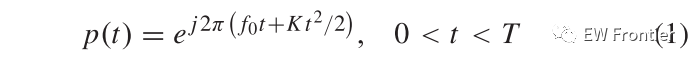
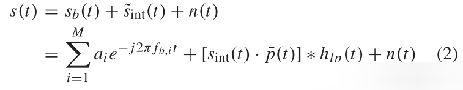
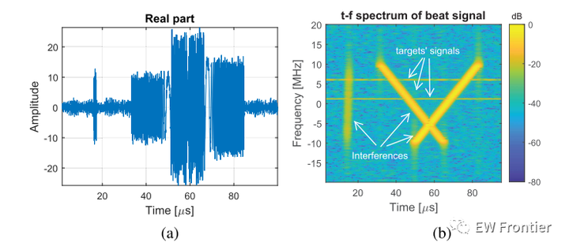
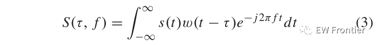
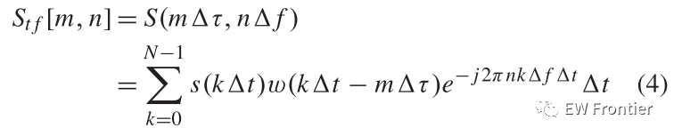
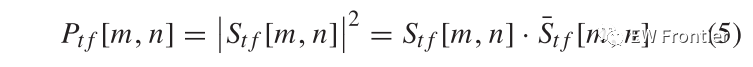
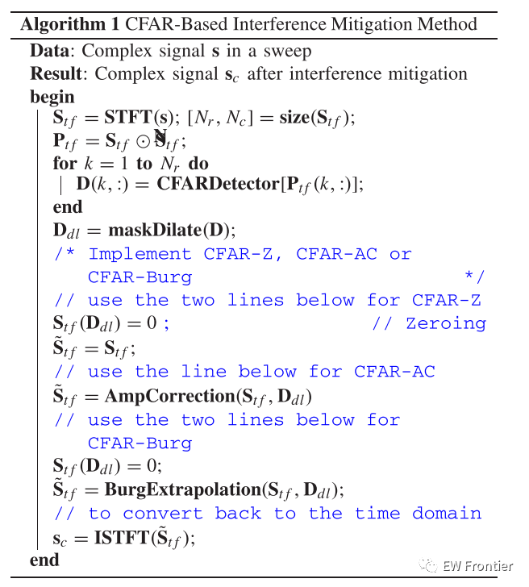
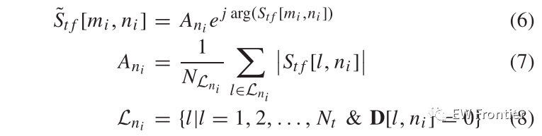
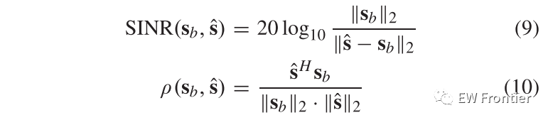
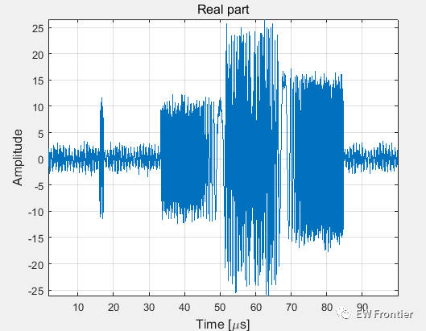
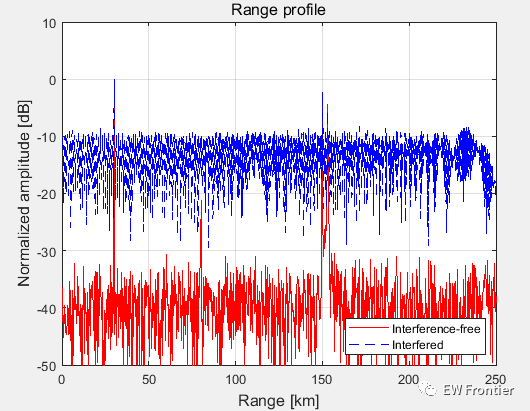
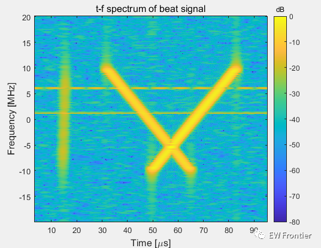
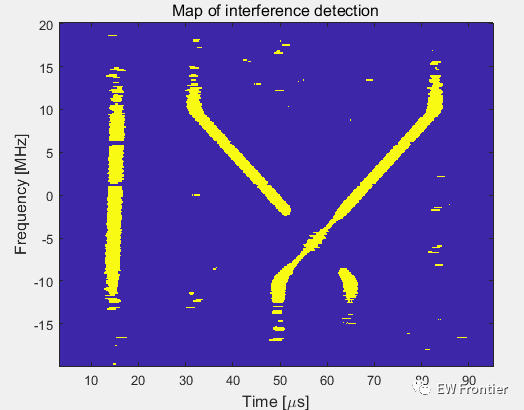
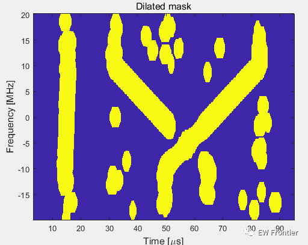
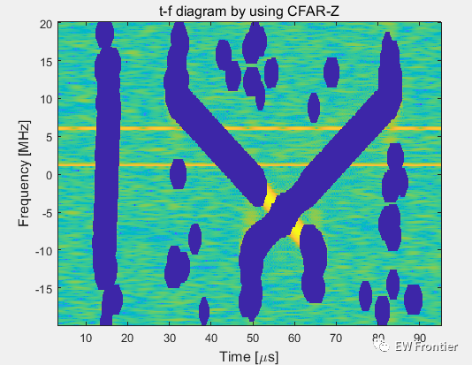
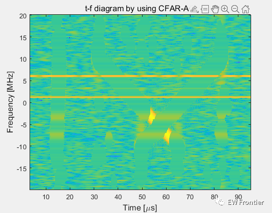
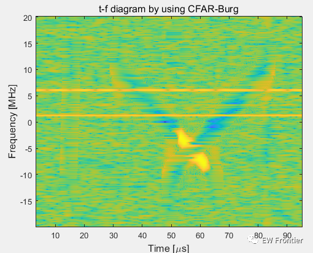
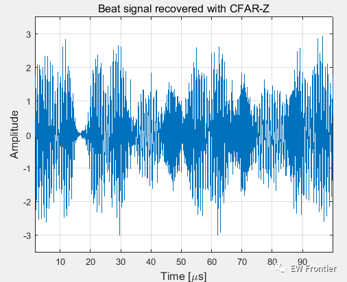
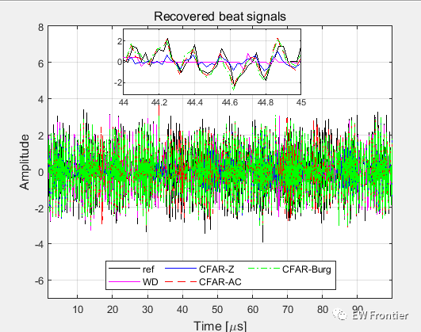
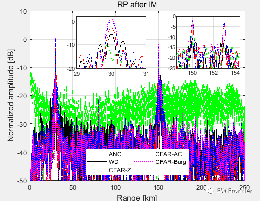

<!-- PAYMENT_BLOCK -->

## Get this dataset

- Payment link (Stripe): [Buy now](https://buy.stripe.com/3cs8yP7sY87d0vu9AB)
- Payment QR code: 

<!-- /PAYMENT_BLOCK -->
